 

> I make websites that look *very* good — and when I'm not doing that, I'm theming Steam and building terminal toys.

 

### ◐ Steam themes for [Millennium](https://steambrew.app)

| Theme | Vibe |
|:--|:--|
| [**steam-chroma**](https://github.com/ethembeldagli/steam-chroma) | Recolours itself to match the game you're playing |
| [**steam-aurora**](https://github.com/ethembeldagli/steam-aurora) | Floating violet glass |
| [**steam-ember**](https://github.com/ethembeldagli/steam-ember) | Warm and cinematic |
| [**steam-paper**](https://github.com/ethembeldagli/steam-paper) | Light, editorial |
| [**steam-monolith**](https://github.com/ethembeldagli/steam-monolith) | Brutalist terminal |

Plus [**millennium-bazzite**](https://github.com/ethembeldagli/millennium-bazzite), an unofficial installer that gets Millennium running on Bazzite.

### ▲ Terminal

- [**roastfetch**](https://github.com/ethembeldagli/roastfetch) — a system fetch tool that roasts your setup
- [**termwrapped**](https://github.com/ethembeldagli/termwrapped) — your year in the terminal, Wrapped-style, with a share card

### ◆ Web

- [**fmhy-desktop**](https://github.com/ethembeldagli/fmhy-desktop) — unofficial FMHY desktop client
- [**nicestartpage**](https://github.com/ethembeldagli/nicestartpage) — a browser start page that's actually nice
- [**elasticcursoreffects**](https://github.com/ethembeldagli/elasticcursoreffects) · [**ASCII-rain**](https://github.com/ethembeldagli/ASCII-rain) · [**pointlessprojects**](https://github.com/ethembeldagli/pointlessprojects) — small experiments

 

Written in HTML · CSS · JavaScript · TypeScript · Python · Shell — from Cambridge, UK.
 
Need a website that stands out? Open an issue or reach out.
